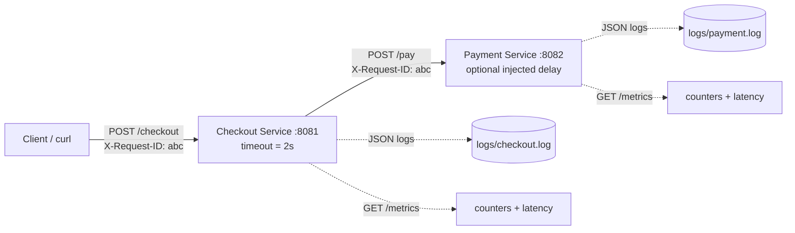

# Module 9: Fault Tolerance & Observability

This project has two small Python services, **Checkout** and **Payment**. Checkout calls Payment for every order. Both services write structured logs, record latency and success/failure metrics, and pass a shared **request ID** between them. That request ID lets you follow a timeout failure from one service to the other.

* Language: Python 3 (standard library only, no `pip install` needed)
* Checkout Service: `http://localhost:8081`
* Payment Service: `http://localhost:8082`

## Architecture



```
 client ──POST /checkout──▶ Checkout (:8081) ──POST /pay (timeout 2s)──▶ Payment (:8082)
          X-Request-ID          │                 X-Request-ID              │
                                ▼                                           ▼
                      logs/checkout.log                             logs/payment.log
                      GET /metrics                                  GET /metrics
```

| File | Purpose |
|---|---|
| `checkout_service.py` | Receives orders, calls Payment with a 2s timeout, returns 504 on timeout |
| `payment_service.py` | Processes payments; has an adjustable delay used for the failure test |
| `common.py` | Shared JSON logger and in-memory metrics (counts, error rate, avg/p50/p95/max latency, last-10 window) |
| `demo.sh` | Runs the full success → failure → recovery scenario |
| `evidence/` | Output and logs captured from a real run |

### What each service records

| Requirement | How it is implemented |
|---|---|
| Request logs | One JSON line per event (`checkout_received`, `calling_payment`, `payment_received`, `payment_completed`, `payment_timeout`, ...), written to stdout and `logs/<service>.log` |
| Request latency | `latency_ms` in every completion or failure log line, plus avg/p50/p95/max in `/metrics` |
| Success/failure count | `requests_success`, `requests_failure`, `failure_reasons`, `error_rate` in `/metrics` |
| Shared request/trace ID | Checkout reads `X-Request-ID` from the client, or generates a UUID if there isn't one. It forwards the ID to Payment in the same header, and both services include `request_id` in every log line |

## Running the services

Requires Python 3.8+ and `curl`. Open two terminals in this folder:

```bash
python3 payment_service.py
```

```bash
python3 checkout_service.py
```

Optional environment variables:

| Variable | Default | Meaning |
|---|---|---|
| `CHECKOUT_TIMEOUT_SECONDS` | `2` | How long Checkout waits for Payment |
| `PAYMENT_DELAY_SECONDS` | `0` | Delay injected into Payment at startup |
| `PAYMENT_URL` | `http://localhost:8082` | Where Checkout finds Payment |

Then, in a third terminal, run the whole scenario:

```bash
./demo.sh
```

Or run the steps by hand:

```bash
# successful request
curl -X POST localhost:8081/checkout -H "X-Request-ID: my-req-1" -d '{"amount": 49.99}'

# inject a 5s delay (longer than the 2s Checkout timeout), without restarting
curl -X POST localhost:8082/admin/delay -d '{"seconds": 5}'

# remove the delay
curl -X POST localhost:8082/admin/delay -d '{"seconds": 0}'

# metrics
curl localhost:8081/metrics
curl localhost:8082/metrics

# follow one request across both services
grep '"my-req-1"' logs/checkout.log logs/payment.log
```

## Results

All output below comes from a real run of `./demo.sh`. The full files are in [`evidence/`](evidence/):
[`demo_output.txt`](evidence/demo_output.txt), [`trace_by_request_id.txt`](evidence/trace_by_request_id.txt), [`checkout.log`](evidence/checkout.log), [`payment.log`](evidence/payment.log).

### 1. Successful Checkout → Payment request

```
$ curl -X POST localhost:8081/checkout -H "X-Request-ID: success-1" -d '{"amount": 49.99}'
{"status": "success", "order_id": "ord_46d4c8f9", "payment_id": "pay_13d7d7ea5f", "request_id": "success-1", "latency_ms": 41.43}  [HTTP 200, 0.052568s]
```

The same request ID appears in the logs of both services:

```
$ grep -h '"success-1"' logs/checkout.log logs/payment.log | sort -s -t'"' -k4,4
{"ts": "2026-11-23T19:59:20.047+00:00", "service": "checkout", "level": "INFO", "event": "checkout_received", "request_id": "success-1", "order_id": "ord_46d4c8f9", "amount": 49.99}
{"ts": "2026-11-23T19:59:20.047+00:00", "service": "checkout", "level": "INFO", "event": "calling_payment", "request_id": "success-1", "order_id": "ord_46d4c8f9", "url": "http://localhost:8082/pay", "timeout_s": 2.0}
{"ts": "2026-11-23T19:59:20.087+00:00", "service": "payment", "level": "INFO", "event": "payment_received", "request_id": "success-1", "order_id": "ord_46d4c8f9", "amount": 49.99}
{"ts": "2026-11-23T19:59:20.088+00:00", "service": "payment", "level": "INFO", "event": "payment_completed", "request_id": "success-1", "order_id": "ord_46d4c8f9", "payment_id": "pay_13d7d7ea5f", "status": 200, "latency_ms": 0.21}
{"ts": "2026-11-23T19:59:20.088+00:00", "service": "checkout", "level": "INFO", "event": "checkout_completed", "request_id": "success-1", "order_id": "ord_46d4c8f9", "payment_id": "pay_13d7d7ea5f", "status": 200, "latency_ms": 41.43}
```

Checkout metrics after 5 successful requests:

```json
{"requests_total": 5, "requests_success": 5, "requests_failure": 0, "error_rate": 0.0,
 "latency_ms": {"avg": 10.51, "p50": 2.86, "p95": 41.43, "max": 41.43}}
```

### 2. Failure test: Payment delay (5s) longer than Checkout timeout (2s)

```
$ curl -X POST localhost:8082/admin/delay -d '{"seconds": 5}'
{"delay_seconds": 5.0}

$ curl -X POST localhost:8081/checkout -H "X-Request-ID: timeout-1" -d '{"amount": 49.99}'
{"status": "failed", "order_id": "ord_38310731", "reason": "payment_timeout", "request_id": "timeout-1", "latency_ms": 2004.23}  [HTTP 504, 2.006109s]
... (timeout-2 through timeout-5 behave the same way)
```

**Checkout detects the timeout:** it gives up after exactly about 2.0s and returns **HTTP 504** with `reason: payment_timeout`. It does not hang for the full 5s.

**The service keeps running:** right after the 5 timeouts:

```
$ curl localhost:8081/health
{"status": "ok", "service": "checkout"}
```

**Logs show the failed request, and the request ID follows it across both services:**

```
$ grep -h '"timeout-1"' logs/checkout.log logs/payment.log | sort -s -t'"' -k4,4
{"ts": "...20.222", "service": "checkout", "level": "INFO",  "event": "checkout_received", "request_id": "timeout-1", "order_id": "ord_38310731", "amount": 49.99}
{"ts": "...20.222", "service": "checkout", "level": "INFO",  "event": "calling_payment",   "request_id": "timeout-1", "url": "http://localhost:8082/pay", "timeout_s": 2.0}
{"ts": "...20.225", "service": "payment",  "level": "INFO",  "event": "payment_received",  "request_id": "timeout-1", "order_id": "ord_38310731", "amount": 49.99}
{"ts": "...20.225", "service": "payment",  "level": "WARN",  "event": "injected_delay",    "request_id": "timeout-1", "delay_s": 5.0}
{"ts": "...22.227", "service": "checkout", "level": "ERROR", "event": "payment_timeout",   "request_id": "timeout-1", "timeout_s": 2.0, "status": 504, "latency_ms": 2004.23, "detail": "Payment Service did not respond within 2.0s"}
{"ts": "...25.229", "service": "payment",  "level": "INFO",  "event": "payment_completed", "request_id": "timeout-1", "payment_id": "pay_43c96797c1", "status": 200, "latency_ms": 5003.96}
```

Reading this trace:

1. Payment received the request about 3 ms after Checkout sent it, so the network and Payment were both reachable.
2. Payment logged the injected 5s delay, which identifies the root cause.
3. At +2.0s Checkout logged `ERROR payment_timeout` and returned 504.
4. At +5.0s Payment finished and issued `pay_43c96797c1`, even though Checkout had already told the client the order failed. This is a real distributed-systems hazard: a timeout doesn't mean the operation failed, only that you stopped waiting. A production system would need an idempotency key and reconciliation to avoid charging the customer for an order they were told had failed. Only the shared request ID makes this visible.

Checkout metrics after the failure phase:

```json
{"requests_total": 10, "requests_success": 5, "requests_failure": 5,
 "failure_reasons": {"payment_timeout": 5}, "error_rate": 0.5,
 "latency_ms": {"avg": 1006.97, "p50": 41.43, "p95": 2004.23, "max": 2004.23},
 "last_10": {"requests": 10, "error_rate": 0.5, "avg_latency_ms": 1006.97}}
```

### 3. Recovery: delay removed

```
$ curl -X POST localhost:8082/admin/delay -d '{"seconds": 0}'
{"delay_seconds": 0.0}

$ curl -X POST localhost:8081/checkout -H "X-Request-ID: recovery-1" -d '{"amount": 49.99}'
{"status": "success", "order_id": "ord_3f9d9300", "payment_id": "pay_79a43eb1f3", "request_id": "recovery-1", "latency_ms": 2.65}  [HTTP 200, 0.003763s]
... (recovery-2 through recovery-10 all HTTP 200, 1.4–5.4 ms)
```

Checkout metrics after recovery:

```json
{"requests_total": 20, "requests_success": 15, "requests_failure": 5,
 "failure_reasons": {"payment_timeout": 5}, "error_rate": 0.25,
 "latency_ms": {"avg": 504.59, "p50": 2.85, "p95": 2003.6, "max": 2004.23},
 "last_10": {"requests": 10, "error_rate": 0.0, "avg_latency_ms": 2.21}}
```

| Checkout metric | After success | During failure | After recovery |
|---|---|---|---|
| Recent error rate (`last_10.error_rate`) | 0.0 | **0.5** | **0.0** |
| Recent avg latency (`last_10.avg_latency_ms`) | 10.5 ms | **1007 ms** | **2.2 ms** |
| Lifetime error rate (`error_rate`) | 0.0 | 0.5 | 0.25 (falling) |
| Per-request latency | 2–41 ms | ~2004 ms (timeout) | 1.4–5.4 ms |

* **Requests succeed again:** all 10 recovery requests returned HTTP 200.
* **Error rate decreases:** the recent error rate went from 50% to 0%, and the lifetime rate fell from 50% to 25%.
* **Latency returns to normal:** recent average latency dropped from about 1007 ms back to about 2 ms.

## Reflection

Each signal answers a different question when diagnosing a failure. **Metrics** show that something is wrong and how bad it is: in this lab, Checkout's error rate jumped to 50% and p95 latency hit exactly 2000 ms, which already pointed to a timeout rather than a crash. **Logs** explain what happened inside each service: Checkout logged `payment_timeout` after 2.0s, and Payment logged an `injected_delay` of 5s. The **shared request/trace ID** links those separate logs into one end-to-end story. With a single grep on `timeout-1` I could see that Payment received the request quickly, was slow rather than down, and eventually completed a charge after Checkout had already reported failure, which no single service's logs would have shown. Together they take you from "something is broken" to the root cause, and they confirm recovery when the metrics return to their baseline.
